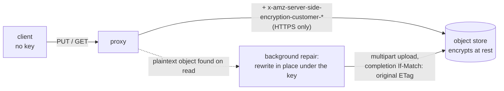

# AWS S3 Reverse Proxy

`aws-s3-reverse-proxy` is a **multi-tenant** S3 reverse proxy. A single shared
instance serves every tenant: it derives the caller's identity from the
request's access-key id, injects that tenant's key prefix itself, authorizes
the request against a declarative policy, and re-signs it with upstream
credentials only the proxy holds.

Two properties drive the design:

  * **Clients stay prefix-blind.** The proxy *injects* the tenant prefix rather
    than validating one the client sent, so a compromised client cannot even
    express a path outside its own scope.
  * **Upstream credentials live in one place.** Only the shared instance holds
    them; clients hold a derived, scope-limited credential that is worthless
    against the object store directly.

The intended clients are untrusted or semi-trusted workloads, so the proxy is
the security boundary — not a convenience layer in front of one.

## How a request is served

1. Verify the inbound [SigV4](https://docs.aws.amazon.com/general/latest/gr/signature-version-4.html)
   header signature against the secret derived for the request's access-key id.
2. Resolve `{tenant, level}` from that access-key id.
3. Inject the tenant key prefix into the object key and into listing parameters.
4. Authorize the HTTP method + key against the policy for that level.
5. Answer object reads from the local cache if one is configured and holds
   the object — after step 4, never before it. An entry past
   `--cache-max-age` is checked against the object store first, and re-served
   if it has not changed.
6. Otherwise re-sign with the upstream credentials and forward, streaming —
   with the operator's SSE-C key added to object reads and writes when one is
   configured (see [Upstream encryption](#upstream-encryption-sse-c)).
7. Strip the prefix back out of `ListObjectsV2` and `DeleteObjects` responses.
   With `--list-fallback`, a listing the object store does not answer is
   answered from the last one it gave (see [Listing fallback](#listing-fallback)).

## Module layout

Each package owns one concern and depends only on packages below it. The
boundaries are the point: everything about *who* a caller is lives in
`policy`, everything about *what S3 looks like on the wire* lives in `s3`, and
neither knows the other exists.

```
cmd/aws-s3-reverse-proxy   the process: flags, secrets, listeners, shutdown
  internal/config          Options, flag parsing, secrets from env or a file
  internal/proxy           the request lifecycle, and only the lifecycle
    internal/policy        the policy document, identity derivation, hot reload
    internal/s3            classification, keys, aws-chunked, XML request and
                           response bodies
    internal/sigv4         inbound signature verification, upstream re-signing
    internal/ssec          the upstream SSE-C key and the headers that carry it
    internal/observability access log, metrics, health probes

    internal/cache         cached upstream responses: freshness, invalidation
      internal/filestore   the disk underneath it
    internal/listcache     remembered listings, in memory, for when the
                           object store does not answer
```

Three seams keep the arrows pointing one way:

- **`proxy.PolicySource`** — `interface { Current() *policy.Policy }`. The
  handler asks for the policy in force once per request; `*policy.Store`
  satisfies it, and so does a fixed policy with no file on disk.
- **`s3.FilterListEntries(body, readable func(key string) bool)`** — the one
  place the S3 package needs an authorization answer takes a predicate, so
  levels and rules stay on the other side of the call.
- **`policy.Store.OnReload`** — the store reports every reload attempt through
  a hook instead of reaching for a logger and a metric registry, which is what
  lets the authorization model be tested without either.

The two cache packages keep the same discipline. `internal/cache` knows what
an HTTP response is and when one goes stale; `internal/filestore` knows only
opaque keys and opaque payloads. Neither knows what S3 is, which tenant asked,
or whether anyone was allowed to — see [Caching](#caching).

## Identity and credential derivation

The access-key id carries the identity; the secret is derived, never stored:

```
secret = hex( HMAC-SHA256( CREDENTIAL_PEPPER, render(identity.secretTemplate) ) )
```

The pepper is a deployment-wide secret shared only between the proxy and
whatever component issues credentials to clients. Both sides derive
independently, so there is no credential store, no per-tenant configuration and
no distribution problem — and rotating the pepper rotates every credential at
once.

A keyed hash is required rather than a plain digest: tenant identifiers are
generally not secret, so an unkeyed `sha256(tenant + level)` would let anyone
who learns a tenant id compute that tenant's highest-privilege secret offline.

Issuing a credential is therefore a pure function. In shell:

```sh
TENANT=$(openssl rand -hex 16)
LEVEL=rw
AWS_ACCESS_KEY_ID="${TENANT}${LEVEL}"
AWS_SECRET_ACCESS_KEY=$(printf '%s' "${TENANT}:${LEVEL}" \
  | openssl dgst -sha256 -hmac "${CREDENTIAL_PEPPER}" -r | cut -d' ' -f1)
```

Both the access-key-id layout and the derivation input are configured, not
hard-coded — see `identity` in the policy file.

## Policy

Three terms, used strictly in this sense throughout:

| Term | Meaning |
| --- | --- |
| **level** | the identity's access level, parsed out of the access-key id. The names come from the config; the proxy has no built-in notion of how many there are or what they mean. |
| **permission** | what a rule grants one level for one path: `deny`, `read` or `full`. |
| **HTTP method** | the literal verb of the request. A permission is a set of these. |

A permission expands to a set of methods:

  * `deny` = nothing at all
  * `read` = `GET` / `HEAD` (a LIST is a `GET`)
  * `full` = `read` plus `PUT` / `POST` / `DELETE`, including every multipart step

The rule list is **ordered and first-match-wins**, with an implicit `deny` at
the end: anything not matched by a rule is denied. See
[`policy.example.yaml`](policy.example.yaml) for the annotated version:

```yaml
identity:
  accessKeyIdPattern: '^(?P<tenant>[0-9a-f]{32})(?P<level>ro|rw|rws)$'
  secretTemplate: '{tenant}:{level}'
  keyPrefixTemplate: '{tenant}/'

levels: [ro, rw, rws]

rules:
  # Denied for the two lower levels, untouched for `rws`.
  - pathPattern: 'datasets/*/private/**'
    grant: { ro: deny, rw: deny, rws: full }

  - pathPattern: 'datasets/**'
    grant: { ro: read, rw: full, rws: full }

  # A more specific carve-out must be expressible *before* the broader rule
  # it sits inside.
  - pathPattern: 'workspaces/*/inbox/**'
    grant: { ro: read, rw: read, rws: read }

  - pathPattern: 'workspaces/**'
    grant: { ro: full, rw: full, rws: full }
```

The nested read-only carve-out inside a writable prefix is the concrete reason
ordering has to be explicit: a set of prefixes cannot express "writable, except
this sub-path".

An explicit `deny` is what the implicit one at the end of the list cannot be.
The implicit deny only applies when *no* rule matched, so on its own it cannot
express either half of what a carve-out usually needs:

  * a hole **inside** a tree a rule already covers — the covering rule matches
    first and grants, and moving the carve-out in front of it needs something
    to put in its `grant` map
  * a path one level must not touch while **another level may** — a rule has to
    cover every declared level, so there is no way to withhold it from one of
    them alone

`deny` is first-match-wins like any other grant: where it matches it decides
the request, no later rule gets a say, and the access log names the rule that
refused it rather than reporting a fall-through.

Path patterns are globs over the **client-facing** key — the key as the client
sent it, before the tenant prefix goes in front of it:

| | |
| --- | --- |
| `**` | any sequence of characters, including `/` |
| `*` | any sequence of characters except `/` |
| `?` | exactly one character except `/` |

A rule's `grant` map must cover **exactly** the declared levels. A rule that
omits one, or names an unknown one, fails validation at startup and names
itself in the error.

### Listings

A listing is authorized on its `prefix` parameter, so `GET /bucket?list-type=2`
with no prefix matches no rule and is denied — add a rule for `**` if a tenant
should be able to enumerate its whole scope. Entries the caller's level cannot
read — whether by an explicit `deny` or by no rule at all — are also removed
from the response, so a denial holds for the listing that would reveal a key
just as much as for a `GET` of it.

## Configuration

Split by lifetime and sensitivity:

| Kind | Source | Contents |
| --- | --- | --- |
| **Policy** | file (e.g. a mounted ConfigMap), hot-reloadable | rule list, access-key-id pattern, key-prefix template, level names |
| **Secrets** | env / mounted secret only | upstream credentials, derivation pepper, optional upstream SSE-C key |
| **Deployment knobs** | flags or env | listen and metrics addresses, upstream endpoint, allowed source subnets, body caps, logging verbosity |

A secret is never readable from the policy file, and the policy file never
needs to change for a tenant.

### Secrets

Secrets are read from the environment only — never from a flag, where they
would show up in `ps`. Every variable also accepts a `…_FILE` form pointing at
a mounted secret, which is what a Kubernetes Secret volume gives you.

| Variable | Meaning |
| --- | --- |
| `UPSTREAM_ACCESS_KEY_ID`, `UPSTREAM_SECRET_ACCESS_KEY` | credentials used to re-sign every upstream request |
| `UPSTREAM_CREDENTIALS` | the same pair as `"ACCESS_KEY_ID,SECRET_ACCESS_KEY"` |
| `CREDENTIAL_PEPPER` | keys the HMAC that derives every client secret (minimum 16 bytes) |
| `CACHE_PURGE_TOKEN` | bearer token required by `POST /cache/purge`; unset leaves that endpoint open |
| `UPSTREAM_SSE_C_KEY` | Base64 of a 32-byte key; when set, every object is encrypted upstream with it (SSE-C) — see [Upstream encryption](#upstream-encryption-sse-c) |

Secrets are read once, at startup. A policy reload does not touch them, and
changing a variable or a mounted file takes effect at the next restart.

### Flags

| Flag (env) | Default | Meaning |
| --- | --- | --- |
| `--policy-file` (`POLICY_FILE`) | *required* | path to the policy document |
| `--policy-reload-interval` (`POLICY_RELOAD_INTERVAL`) | `30s` | how often to re-read it; `0` disables (SIGHUP always reloads) |
| `--allowed-endpoint` (`ALLOWED_ENDPOINT`) | *required* | `Host` header to accept |
| `--allowed-source-subnet` (`ALLOWED_SOURCE_SUBNET`) | `127.0.0.1/32` | source subnets to accept, repeatable |
| `--listen-addr` (`LISTEN_ADDR`) | `:8099` | S3 API listener |
| `--health-listen-addr` (`HEALTH_LISTEN_ADDR`) | `:8100` | serves `/healthz` and `/readyz` |
| `--metrics-listen-addr` (`METRICS_LISTEN_ADDR`) | *off* | serves `/metrics` |
| `--upstream-endpoint` (`UPSTREAM_ENDPOINT`) | AWS S3 for `--upstream-region` | `http://…` or `https://…`; a bare host follows `--upstream-insecure` |
| `--upstream-region` (`UPSTREAM_REGION`, or `AWS_REGION`) | `eu-central-1` | region to sign upstream requests for, and to auto-detect the AWS S3 endpoint from |
| `--max-clock-skew` (`MAX_CLOCK_SKEW`) | `15m` | accepted `X-Amz-Date` deviation |
| `--max-chunked-body-size` (`MAX_CHUNKED_BODY_SIZE`) | 64 MiB | cap on a buffered `aws-chunked` body |
| `--max-delete-body-size` (`MAX_DELETE_BODY_SIZE`) | 2 MiB | cap on a `DeleteObjects` body |
| `--max-rewrite-body-size` (`MAX_REWRITE_BODY_SIZE`) | 32 MiB | cap on a buffered XML response |
| `--shutdown-timeout` (`SHUTDOWN_TIMEOUT`) | `30s` | how long to drain in-flight requests |
| `--shutdown-delay` (`SHUTDOWN_DELAY`) | `0s` | how long to keep serving after `/readyz` starts failing |
| `--read-only` (`READ_ONLY`) | `false` | reject every mutation regardless of policy — a maintenance kill switch |
| `--metrics-tenant-label` (`METRICS_TENANT_LABEL`) | `false` | add the tenant id as a Prometheus label |
| `--upstream-sse-c-repair` (`UPSTREAM_SSE_C_REPAIR`) | `false` | with an SSE-C key, rewrite plaintext objects found by a read under it — see [Legacy plaintext objects](#legacy-plaintext-objects) |

`--upstream-endpoint` decides the scheme, so one image serves an in-cluster
S3-compatible backend over `http` and a hosted provider over `https` with no
second flag to keep in sync.

### Cache flags

Caching is off unless `--cache-dir` is set, and every other flag here is
ignored while it is empty. See [Caching](#caching) for what they mean in
practice.

| Flag (env) | Default | Meaning |
| --- | --- | --- |
| `--cache-dir` (`CACHE_DIR`) | *off* | directory to cache object reads in, **unencrypted**, emptied at every start; empty disables caching entirely |
| `--cache-max-bytes` (`CACHE_MAX_BYTES`) | 1 GiB | the most disk the cache ever uses, writes in progress included |
| `--cache-max-object-size` (`CACHE_MAX_OBJECT_SIZE`) | 64 MiB | largest object accepted; bigger ones are proxied without being stored |
| `--cache-max-age` (`CACHE_MAX_AGE`) | `10m` | how long an object is served before it is checked against the object store; `0s` disables expiry entirely |
| `--cache-writes` (`CACHE_WRITES`) | `true` | also cache the body of an accepted upload |
| `--cache-range-fills` (`CACHE_RANGE_FILLS`) | `true` | fetch the whole object in the background when a ranged read misses |
| `--cache-max-entries` (`CACHE_MAX_ENTRIES`) | `0` | object count limit; `0` for none. Budget ~150 bytes of memory each, plus the length of its key |

The last one is an expert knob. The first six are the ones a deployment
actually turns.

`--cache-segment-size` and `--cache-inline-max-size` are retired along with
the segment files they sized. They are still accepted so that a deployment
setting them keeps starting, have no effect, and log a warning at startup.

### Listing fallback flags

`--list-fallback` and its `--list-fallback-*` tuning flags are described in
[docs/listing-fallback.md](docs/listing-fallback.md#configuration).

### Hot reload

The policy file is re-read on `SIGHUP` and, by default, on a timer. A reload
that fails validation is **rejected** and the previously loaded policy keeps
serving — a bad edit must not open or close the gate by accident. Rejections
are logged at error level and counted in
`s3proxy_policy_reloads_total{outcome="rejected"}`.

`SIGHUP` is the immediate path; the timer is the fallback for the case nobody
is around to send one. It is a poll rather than a filesystem watch on purpose:
a Kubernetes ConfigMap update does not write to the file, it swaps the
directory symlink the file is reached through, and an inotify watch registered
on the path stops firing the moment that happens. Watching the parent
directory instead works, but the event to watch for differs by how the volume
is mounted, so the failure mode is a policy that silently stops updating.
Re-reading the bytes costs one small read per interval and is correct
everywhere.

Set `--policy-reload-interval=0` for signal-only operation, and the proxy will
never touch the file except when told to.

## Scoping and fail-closed behaviour

  * Prefix injection covers the object key **and** the `prefix`, `marker` and
    `start-after` parameters of a listing. `continuation-token` is forwarded
    verbatim: it is an opaque value the upstream minted for an already-scoped
    listing, so prefixing it would corrupt it (and with it, pagination), while
    forwarding it is safe precisely because a client cannot obtain a token for
    any other scope.
  * `DeleteObjects` authorizes **each key individually** and returns per-key
    `AccessDenied` entries, matching S3 semantics, rather than rejecting the
    whole batch. When no key survives, the proxy answers directly and makes no
    upstream call at all.
  * Multipart initiate / upload-part / complete / abort require the `full`
    permission, like any other write.
  * Two bucket calls name no key, and are allowed for any authenticated
    caller: `HEAD /bucket` (HeadBucket — what rclone, `mc` and s3fs check
    before anything else) is forwarded, and `GET /bucket?location`
    (GetBucketLocation) is answered by the proxy with the region it signs for
    upstream. That a bucket exists is not any one tenant's to hide; nothing in
    either answer is about a tenant's objects.
  * Key normalization happens **before** injection: `..` segments, a leading
    `/`, percent-encoded (and doubly percent-encoded) traversal and empty keys
    are **rejected**, not silently normalized.
  * Anything not explicitly handled is `403`. The set of understood operations
    is a whitelist, which is how `x-amz-copy-source` (it names a second key
    that would otherwise bypass authorization) and every bucket-level
    administrative call (`?acl`, `?policy`, `?versioning`, `?lifecycle`,
    `?tagging`, bucket create/delete, …) are refused without enumerating them.
  * The AWS SDKs' `?x-id=<Operation>` marker is dropped before a request is
    classified. It is the query-string twin of the telemetry headers below —
    it describes what the SDK believes it is sending, instructs nothing, and
    is never what decides the operation. The URL forwarded upstream keeps it,
    so the signature still covers what the client signed.
  * Request **headers** are a whitelist too. A tenant may set what describes
    its own object — `Content-Type`, `Content-Md5`, `Content-Encoding`,
    `Content-Disposition`, `Content-Language`, `Cache-Control`, `Expires`,
    `Range`, the conditional `If-*` headers, `Accept-Encoding`, and the
    `x-amz-meta-*` and `x-amz-checksum-*` families. Client telemetry that
    carries no instruction — `x-amz-user-agent` (what a browser SDK sends
    because the Fetch spec forbids it setting `User-Agent`), `x-amz-te` and
    the `x-amz-sdk-*` family — is accepted but not forwarded. Every other
    `x-amz-` header is `403`, because one the proxy does not understand is
    one it cannot authorize: `x-amz-acl`, `x-amz-object-lock-*`,
    `x-amz-tagging`, `x-amz-storage-class` and `x-amz-server-side-encryption`
    are all decisions that belong to the operator and are made on the bucket.
    A client's own SSE-C key (`x-amz-server-side-encryption-customer-*`, and
    the `x-amz-copy-source-…` variants) is refused before anything else with
    `400 InvalidRequest` and a message saying that key passthrough is not
    supported. The headers are never silently dropped: a client would then
    believe its object is encrypted under a key it chose.
  * Whatever is forwarded is also **signed** upstream. Headers are copied onto
    the upstream request before it is signed, never after, so nothing reaches
    the object store outside the proxy's own signature.
  * Anonymous requests, unknown access-key ids, wrong signatures and
    query-string (presigned) requests are `403`.
  * `X-Amz-Date` skew tolerance is bounded and configurable, which is what
    stops a captured signature from being replayed indefinitely.

## Runtime behaviour

Request and response bodies stream, and per-request memory is independent of
object size: the payload hash a client already signed is reused for the
upstream signature instead of reading the upload to compute one.

Two paths must buffer, and both carry an explicit, configurable cap: a
`DeleteObjects` body (its keys have to be authorized and prefixed one by one)
and an `aws-chunked` body that announces a checksum **trailer** (the digest
arrives after the payload, while the upstream needs it in a header before it).
An `aws-chunked` body without a trailer is de-chunked as a stream.

Measured added latency for `GET`/`HEAD` is well inside the 5 ms p99 budget;
`TestAddedLatencyP99` measures it against the same upstream reached directly
and fails the build if it regresses past it.

An object served from the local cache never reaches the object store at all,
and is answered by `http.ServeContent` — which brings correct `Range`,
`If-None-Match`, `If-Range` and `416` handling with it. See
[Caching](#caching).

`/healthz` and `/readyz` live on their own listener — on the S3 one, a path
like `/healthz` would be indistinguishable from a bucket named `healthz`.
`SIGTERM` flips `/readyz` to 503 and then drains in-flight requests, so a
rolling restart of a multi-replica deployment drops nothing.

Client compatibility: clients that sign a real payload hash (e.g. DuckDB's
`httpfs`, which also signs with an empty region scope) and clients that send
`aws-chunked` bodies (e.g. the AWS JS SDK v3) both work unchanged.

## Caching

Set `--cache-dir` and object reads are answered from local disk instead of the
object store. Everything else about the proxy is unchanged; leave it unset and
none of this code runs.

It is aimed at a workload of many small files read over and over — Parquet and
DuckDB files behind a query engine — on a proxy that is the only thing writing
to the bucket.

The directory is meant to be a local volume that lives as long as the pod,
an `emptyDir` on local NVMe, and it is **emptied at every start**: nothing
cached survives a restart. See [On disk](#on-disk).

### What it does and does not cache

| | |
| --- | --- |
| `GetObject`, `HeadObject` | served from the cache, and stored on the way past. A `HEAD` is answered out of a cached `GET`. |
| Ranged reads | answered from a cached object, Range arithmetic and all — including after a revalidation. A ranged **miss** is proxied straight through and the whole object is fetched in the background, see below. |
| `PutObject` | invalidates the object, and with `--cache-writes` the uploaded body is kept, so writing an object leaves it cached. |
| `DeleteObject`, `DeleteObjects`, `CompleteMultipartUpload` | invalidate every key they touch. |
| `ListObjectsV2` | **never answered from the cache.** A listing always goes to the object store; see [Listing fallback](#listing-fallback) for the outage case. |
| Multipart parts | not cached. The object does not exist until the upload is completed, and completing it invalidates the key. |

An object marked `Cache-Control: no-store` or `private` is not stored: those
are statements about the object, and this is a shared cache. Freshness
directives (`max-age`, `no-cache`) are ignored — how long an entry may be
served is the deployment's decision, made once in the configuration, not one
an object's own metadata makes on its behalf.

A request carrying `If-Match` or `If-Unmodified-Since` bypasses the cache
entirely. Those are not freshness questions but concurrency primitives: the
caller is asking the object store to decide about the object's current state,
and a cache answering on its behalf would break exactly what the caller is
relying on.

### Ranged reads, and why the background fetch exists

A client like DuckDB's `httpfs` reads an object almost entirely in ranges: a
Parquet footer, then row groups, then column chunks. A cache that only ever
filled from whole-object reads would never see one, and its hit rate against
that workload would be exactly zero.

So a ranged read that misses is proxied through unchanged — the client gets
its bytes at full speed from the object store — and the whole object is
fetched separately in the background, bounded by `--cache-max-object-size`.
Every range after that is answered from disk. Concurrent ranged reads of the
same cold object trigger one fetch between them, and at most four fetches run
at a time so that work nobody asked for cannot crowd out work somebody did.
`--cache-range-fills=false` turns it off.

### What keeps it correct

Five rules, and every line of `internal/proxy/cache.go` is one of them:

  * The cache is consulted **after** authentication and authorization, never
    before. A hit answers a request that was already going to be allowed; it
    can never answer one that would have been refused. `ro` reading an object
    that `rws` cached is still a `403`, and the object store is not consulted
    either.
  * The key names the **upstream** object — bucket plus the injected tenant
    prefix — never what the client asked for. Two tenants that both call
    something `data/a.parquet` are two different keys by construction, which
    is not something any code path has to remember to check.
  * What is stored is what the **upstream** sent, before any tenant rewriting.
  * Nothing is committed until the upstream confirmed it **and** the whole
    announced length arrived. A client that hangs up halfway does not leave a
    truncated object behind.
  * The cache never delays or fails a request. Every error path ends in "then
    don't cache it" — out of disk, over the size limit, store busy. A cache
    that can break a read is worse than no cache.

Response headers are a whitelist like request headers are: `Content-Type`,
`Content-Encoding`, `Content-Disposition`, `Content-Language`,
`Cache-Control`, `Expires`, `ETag`, `Last-Modified` and the `x-amz-meta-*`
family are stored and replayed. `Date`, `Server`, `x-amz-request-id` and
`x-amz-id-2` are not: they identify one exchange with the object store, and
replaying somebody else's request id is a false trail through two systems'
logs.

### Staleness, and the one thing the cache cannot see

Every write **through this proxy** invalidates what it touched, so the only
way an entry can go stale is a write that did not go through it: another
client, a lifecycle rule, replication, the console.

`--cache-max-age` bounds how long that can last. After it, the next read does
not throw the entry away — it asks the object store whether the object has
changed, with a `HEAD`, and compares the ETag:

  * **unchanged** — the object is served from disk and the entry is current
    again. One round trip, no body over the network. Reported as
    `X-Cache: REVALIDATED`.
  * **changed, or nothing to compare** — the object is fetched normally and
    replaces the entry. `X-Cache: STALE`.

A `HEAD` rather than a conditional `GET`, deliberately. Both cost one round
trip when the object is unchanged, which is the case worth optimising — but a
conditional `GET` that comes back `200` carries the whole object, and the
request that issued it is in no position to stream that anywhere. Discarding
the body would spend exactly the egress the revalidation was there to save.
Anything the check cannot answer for certain — no ETag on either side, an
error, an unexpected status — falls through to an ordinary fetch: being wrong
in that direction costs a transfer, being wrong in the other serves a stale
object.

Revalidation is not a separate switch. It is what expiry does, so
`--cache-max-age` is the only knob: shorter means the object store is asked
about a given object more often, and never means a full re-transfer unless
something actually changed.

A revalidation records *which version* of the object it confirmed, not just
that it confirmed one. Otherwise a check that started before an upload and
finished after it — having asked about the version the upload replaced — would
make the replacement look fresher than it is.

`--cache-max-age=0s` turns expiry off altogether. That is correct exactly when
this proxy is the only writer, and the startup log **warns** about it rather
than leaving it in the flag help:

```
level=warning msg="Cached objects never expire (--cache-max-age=0): only writes
through this proxy invalidate them. If anything else writes to the bucket, an
object can be served stale indefinitely — set --cache-max-age, or POST
/cache/purge when it happens."
```

That purge endpoint is the escape hatch for a write that happened outside the
proxy and cannot wait for expiry:

```
curl -X POST http://<health-listen-addr>/cache/purge
```


It lives on the admin listener and nowhere else. On the S3 port,
`/cache/purge` is indistinguishable from a request for an object called that,
and a bucket named `cache` would put it within reach of any tenant.

Being on a separate listener is not the same as being protected, though.
**Setting `--cache-dir` turns the health listener into a mutating one**: every
other route on it is a read-only probe, and this one empties the cache. Without
a token, anything that can reach that port can empty it in a loop, which is a
cheap way to force full re-fetches from the object store and spend exactly the
egress this feature exists to save. Set the token, or make sure the network
policy on that port really does scope it to whatever is meant to reach it:

```
CACHE_PURGE_TOKEN=…              # or CACHE_PURGE_TOKEN_FILE, like the other secrets
curl -X POST -H 'Authorization: Bearer …' http://<health-listen-addr>/cache/purge
```

(It is on `--health-listen-addr`. That address shares a mux with
`--metrics-listen-addr` when the two are set to the same thing, which is the
usual arrangement.)

With no token set, the endpoint is open to whatever can reach the port, and
the startup log says so.

All of the above is exercised end to end against a real MinIO, by a fourth
proxy variant in `e2e/` that runs the whole suite with the cache on — so a
cache that answered a request policy would have refused fails the isolation
and authorization tests rather than a test written to look for it. The
external-writer case is staged for real there too: the suite writes into the
bucket behind the proxy's back and checks that the object is served stale
until the maximum age and no longer. See `e2e/README.md`.

One caveat is worth stating for the workload above. A Parquet reader mixing a
cached footer with a freshly fetched row group does not get old data, it gets
garbage — the offsets no longer describe the file. Whole objects are cached,
revalidated and invalidated atomically, so this cannot happen within the
proxy; it is a reason to take an external writer seriously rather than to set
`--cache-max-age` loosely.

### More than one replica

Each replica has its own cache, and neither the writes nor the invalidations
that pass through one reach the other. The hit rate divides by the replica
count, which is the small half of it. The large half is that **read-after-write
stops being guaranteed**: write an object through replica A and read it back
through replica B, and B answers from whatever it last cached — for up to
`--cache-max-age`, without asking the object store at all.

Two ways to be correct about that, and a cache-enabled deployment wants one of
them:

  * **Route by key**, or run a single replica. Then an object is only ever
    cached by the replica that also sees its writes, and read-after-write
    holds as it does without a cache. A plain round-robin Service is not this.
  * **Accept the window and bound it deliberately** with `--cache-max-age`,
    knowing that a client which writes through the proxy and immediately reads
    back may get the previous version until it expires.

This is not something the proxy can detect or warn about — a replica cannot
see its siblings — so it is stated here rather than at startup. How to route
by key on Kubernetes, and how to purge every replica's cache, is in
[Running on Kubernetes](docs/kubernetes.md#more-than-one-replica).

### On disk

Every cached object is a file in `--cache-dir`, indexed in memory. Three
things about it matter to an operator:

  * **`--cache-max-bytes` is a ceiling** on everything the cache has on disk,
    writes in progress included. Room is made by evicting before a write, and
    an object that does not fit is not cached.
  * **The directory is emptied at every start.** A restart costs a cold
    cache; nothing an earlier process cached is ever served.
  * **Cached objects are stored unencrypted, always.** A file holds the
    plaintext the object store returned, whatever encryption the object store
    applies to its own copy: SSE-S3, SSE-KMS, or this proxy's
    [SSE-C](#encryption-and-the-cache). Anybody who can read the volume can
    read every tenant's cached objects. The directory is created `0700`;
    encrypting the disk underneath it is the operator's to arrange. Without
    `--cache-dir`, the proxy keeps no object data at rest at all.

How to size the volume and the pod for it, and what node disk pressure does:
[Running on Kubernetes](docs/kubernetes.md#the-object-cache). How the store
underneath works: [How the cache stores objects](docs/cache-storage.md).

## Listing fallback

With `--list-fallback`, a listing the object store does not answer within one
second, or fails with a server error, is answered with the last answer the
object store gave to it. Listings still always go to the object store first;
every write through the proxy drops the remembered listings it affects, and
refreshes them in the background once writes have settled. It is off by
default, because writes that bypass this process can be missing from such an
answer for up to `--list-fallback-max-age`.

Flags, consistency rules and metrics: [docs/listing-fallback.md](docs/listing-fallback.md).

## Upstream encryption (SSE-C)

Set `UPSTREAM_SSE_C_KEY` (or `UPSTREAM_SSE_C_KEY_FILE`) and every object is
stored encrypted with that key. The object store does the AES-256; the proxy
supplies the key with each request, over HTTPS. Clients change nothing: they
send no key, receive no key, and never see the response headers that would
show one was involved.

```sh
openssl rand -base64 32 > sse-c-key      # 32 random bytes, Base64
UPSTREAM_SSE_C_KEY_FILE=/etc/s3proxy/secrets/sse-c-key
```



### Configuration

| | |
| --- | --- |
| neither variable set | SSE-C off; behaviour is exactly what it was without this feature |
| a valid key | SSE-C on. There is no separate switch |
| empty value, empty or unreadable file, malformed or wrong-length key, both variables set | **startup fails** |
| key set and an `http://` upstream | **startup fails**: the key would cross the network in the clear |

The key is independent of the upstream credentials and of `CREDENTIAL_PEPPER`,
and nothing is derived from either. It is never accepted as a flag or from the
policy file, and it is loaded once: neither a policy reload nor an edit of the
mounted file changes it before a restart. Startup checks that the key is
well-formed. Whether it is the key an existing object was written with only
shows when that object is read, and there is deliberately no startup scan of
the bucket to find out.

Provisioning and distributing the key is the operator's job. Lose it and the
objects written with it are unreadable — by this proxy and by anybody else.

### What carries the key

| Operation | Upstream request |
| --- | --- |
| `GetObject`, `HeadObject`, `PutObject` | key |
| `CreateMultipartUpload`, `UploadPart` | key (S3 requires it on every part) |
| `CompleteMultipartUpload`, `ListParts` | key (AWS needs it there for uploads with checksums, and accepts it otherwise) |
| `AbortMultipartUpload`, `DeleteObject(s)`, `ListObjects` | no key |

The cache's own requests (the freshness `HEAD` of an expired entry, the
background fetch after a ranged miss) carry it the same way.

A write the store accepts **without confirming** encryption — no
`x-amz-server-side-encryption-customer-algorithm` in the response, or another
key's digest — is logged as a warning and otherwise treated as the success it
is: the client gets its `200` and the cache behaves as usual. It is never
failed after the fact, and never retried without the key. A write the store
refuses stays refused. In other words this mode asks for encryption and
reports when the store does not confirm it; it cannot force a store that
ignores SSE-C to encrypt.

An upstream **error** is rebuilt from the fields a client may see (`Code`,
`Message`, `Key`, `BucketName`, `Resource` and the request ids) before it
is passed on, and the key is redacted from whatever is left. An object
store's error describes the request it received, which is the proxy's
re-signed one: `SignatureDoesNotMatch` quotes it whole, customer key and
upstream access key id included.

Reading an object encrypted under a **different** key (or, with no key
configured, any SSE-C object) returns the store's error to the client and logs
it at error level. It never triggers a read without the key, nor a rewrite.

### Legacy plaintext objects

Objects written before the key existed are always served. With
`UPSTREAM_SSE_C_REPAIR=true` they are also encrypted the first time somebody
reads them; without it they are left as they are, and the log says so:

1. **Detection.** The pinned MinIO, like S3, refuses a read of a plaintext
   object that carries SSE-C headers (`400 InvalidRequest`, "The encryption
   parameters are not applicable to this object"). On that answer — and only
   that one; for a `HEAD`, whose error has no body, any `400` — the proxy asks
   once more with a `HEAD` *without* the key. Only a `200` that names no
   customer algorithm counts as proof of plaintext. A timeout, a `403`, any
   other status, or a store that says the object *is* encrypted, leaves the
   client with the original error. An object stored with SSE-S3 or SSE-KMS
   reads the same way as a plaintext one here, and is treated as one: it is
   served, and rewritten under the customer key.
2. **Serving.** The client's own request is re-sent without the key, with its
   `Range` and conditions intact, and streamed back as usual, caching
   included. The read does not wait for the repair, and a failing repair never
   turns it into an error.
3. **Repair**, only with `UPSTREAM_SSE_C_REPAIR=true`, in the background, at
   most two at a time:
   - observe the object (`HEAD` without the key): ETag, size,
     `Last-Modified`, version id, content headers and `x-amz-meta-*`;
   - read its ACL, and go no further unless it is the default (the
     owner's full control and nothing else);
   - start a multipart upload **with** the key, carrying those headers over;
   - stream the whole object (`GET`, `If-Match` the observed ETag) into parts
     of 16 MiB or more. Memory stays bounded whatever the object's size, and
     a ranged response is never used as the replacement body;
   - check that the upload will belong to the object's current owner;
   - observe again, ACL included, and abandon if anything changed —
     metadata replaced in place, which can leave an ETag as it was, or tags,
     retention or a hold added while the parts were uploading;
   - complete the upload with `If-Match: "<observed ETag>"`. If anything
     replaced the object in the meantime the store answers `412`, and if it
     was deleted, `404`. The upload is aborted either way and nothing is
     retried unconditionally, so a concurrent write always wins and a deleted
     object stays deleted.

   The completion carries no key. MinIO evaluates a precondition by reading
   the existing object *with* the request's key, which fails for a plaintext
   object. That is also why the repair is always a multipart upload: a
   conditional SSE-C `PutObject` over a plaintext object is refused by MinIO.
   AWS S3 accepts `If-Match` on `CompleteMultipartUpload` and needs no key
   there for an upload without checksums.

**Why repair is opt-in.** The completion's `If-Match` is the only condition
an object store enforces on a replacement, and an ETag does not cover
metadata: a writer that stores byte-identical content with new metadata
leaves it unchanged. MinIO ignores `If-Unmodified-Since` on a completion,
and AWS S3 does not offer it. So a writer that does exactly that, *without
the key*, in the moment between the repair's last observation and its
completion would have its metadata overwritten. Writes through this proxy
always carry the key, which gives them a fresh ETag, so they are never
affected. Turn repair on once nothing writes the bucket without the key.

The rewrite gives an object the default ACL, so an object with any other
grant is skipped rather than silently opened up or locked down, and so is
one whose rewrite would change its owner. MinIO has no object ACLs and
reports exactly the default.

An object whose encryption is not confirmed — served without the key, read
or written without the store confirming the key — is cached with that
question attached. A cache hit on such an entry has the object checked
again, within the same retry and suspension bounds, so a long cache
lifetime cannot hide it.

**Conditional writes** onto an object that is still plaintext need the same
care. MinIO evaluates the precondition of a write that carries the key by
reading the existing object *with* that key, so `If-Match` or `If-None-Match`
over a plaintext object would come back `400` instead of `200` or `412`:

  * A conditional `PutObject` is preceded by a keyless `HEAD` of its target
    (one extra round trip, only for conditional PUTs). If the target is
    plaintext, the PUT is carried out as a one-part encrypted multipart
    upload whose completion carries the client's own condition and no key,
    so the store evaluates it against the object the client asked about.
    The client gets an ordinary PUT answer; the object is encrypted. Its
    flexible checksum headers are not carried over (`Content-MD5` is).
  * A conditional `CompleteMultipartUpload` the store refuses that way is
    sent once more without the key. Its body is already buffered, and the
    assembled object is encrypted regardless, because the initiation and
    every part carried the key.

A repair is **skipped**, and the reason logged, when the proxy runs with
`--read-only`, when no level of the current policy may write the path (an
operator who made a path read-only for everybody did not mean it to be
rewritten), when the object has tags, object-lock retention, a legal hold or
access grants beyond its owner's (a rewrite would drop them), when its ACL
cannot be read, when the rewrite would change its owner, when it is
archived, or when the store gave no strong ETag. A store that answers `501` to the conditional completion gets no
repairs at all, rather than unconditional ones; neither does a store that
accepts a repair's encrypted write without confirming it. Both suspend repairs
for an hour, so a bucket is not rewritten object by object to no effect. An
object that was tried, successfully or not, is left alone for ten minutes; a
later read after that retries it. In-flight repairs are cancelled on shutdown
and their uploads aborted.

What an operator should know before turning this on:

  * **Credentials.** The proxy's upstream credentials need to write the
    objects they read: `PutObject` and the multipart actions, including
    `AbortMultipartUpload` and `ListMultipartUploadParts`, plus
    `GetObjectAcl` to check an object's grants before it is rewritten.
  * **Conditional writes.** The store must enforce `If-Match` on
    `CompleteMultipartUpload` (AWS S3 and MinIO do). A store that silently
    ignores the header cannot be told apart from one that honours it.
  * **What changes.** A repaired object has the same bytes, content headers
    and user metadata, and a new ETag, `Last-Modified` and (in a versioned
    bucket) version id. A versioned bucket keeps the plaintext as the previous
    version. Stored checksums are not carried over.
  * **Traffic.** Each repair reads the object once more and writes it once.
  * **Coverage.** Only objects that are read get repaired. Objects nobody
    reads, failed or skipped repairs and old versions stay in plaintext. This
    is opportunistic encryption, not a migration — and there is no key
    rotation, no per-tenant key, and no second key to read old objects with.

### ETags

ETags are opaque values to the proxy, and it keeps them in one canonical form:
the value with any matching surrounding quotes removed, however nested. At
least one object store answers `ETag: "'abcef123'"` and then refuses that same
value, single quotes included, as a precondition or in a part list.

| Received | Canonical | Sent as an HTTP validator | Sent in a part list |
| --- | --- | --- | --- |
| `abcef123` | `abcef123` | `"abcef123"` | `abcef123` |
| `"abcef123"` | `abcef123` | `"abcef123"` | `abcef123` |
| `'abcef123'` | `abcef123` | `"abcef123"` | `abcef123` |
| `"'abcef123'"` | `abcef123` | `"abcef123"` | `abcef123` |

Weak validators stay weak. Apostrophes inside a value, its case and a
multipart `-N` suffix are left alone, and an ETag is never taken for the MD5
of the bytes (under SSE-C it is not). Cache freshness checks, replayed
validators, client conditions forwarded upstream, multipart completions and
the repair's preconditions all use the canonical value; clients receive the
standard `"abcef123"` form, in headers and in XML.

### Encryption and the cache

With a cache, SSE-C covers the object store and nothing else. The cache
stores the **decrypted** bytes, unencrypted on local disk, so the cache volume
needs protecting on its own terms: see [On disk](#on-disk). The key itself
never reaches the cache directory.

The cache is emptied at every start, so a restart with a different key, or
with none, can never look healthy only because the cache still answers for
objects the store would now refuse to decrypt. Writes made directly to the
bucket, even with the same key, are still external writes to the cache: keep
`--cache-max-age` finite when anything else writes.

## Observability

The structured access log and the authorization metrics carry the same four
facts — tenant, level, decision and the **matched rule** — so a denial is
explainable without a debugger:

```
level=warning msg="request denied" tenant=1f0c… access_level=ro operation=PutObject
  method=PUT key=datasets/2026/a.csv decision=deny rule="datasets/**" status=403
```

(The identity's level is logged as `access_level`, because logrus already
uses `level` for the severity of the line itself.) With a cache configured,
every line also carries `cache=hit|revalidated|stale|miss|bypass`, which is
what turns "the hit rate dropped" into a list of the requests that missed.

No credentials, signatures or `Authorization` header content appear in logs or
in metric labels, at any verbosity. The tenant id is available as a metric
label behind `--metrics-tenant-label`: tenant count is unbounded by design, and
an unbounded label is an unbounded number of time series.

| Metric | |
| --- | --- |
| `s3proxy_authz_decisions_total{tenant,level,operation,decision,rule}` | authorization decisions |
| `s3proxy_batch_delete_denied_keys_total{tenant,level}` | keys refused inside a batch |
| `s3proxy_proxied_request_duration_seconds{operation,decision}` | end-to-end latency |
| `s3proxy_policy_reloads_total{outcome}` | reloads applied / rejected / unchanged |
| `s3proxy_cache_lookups_total{operation,result}` | cache lookups: hit, revalidated, stale, miss, bypass |
| `s3proxy_cache_entries`, `s3proxy_cache_bytes`, `s3proxy_cache_capacity_bytes` | what the cache holds |
| `s3proxy_cache_stores_total`, `s3proxy_cache_store_failures_total` | responses written, and the ones that could not be |
| `s3proxy_cache_invalidations_total` | keys dropped because the object behind them was written |
| `s3proxy_cache_evictions_total`, `s3proxy_cache_evicted_bytes_total` | reclaim, to stay within the size limit |
| `s3proxy_list_fallback_*` | the listing fallback, see [docs/listing-fallback.md](docs/listing-fallback.md#observability) |

The cache series appear only when a cache is configured: a deployment without
one exports nothing rather than a set of zeros that read like an idle cache.
Every object **read** also carries an `X-Cache` header — `HIT`, `REVALIDATED`,
`STALE`, `MISS`, `BYPASS` — so a hit rate is answerable from one request and
not only from a dashboard. Writes and listings carry none: they are not
lookups, and counting them as one would put every upload in the metric as a
bypass. `REVALIDATED` against `STALE` is the pair worth
watching when tuning `--cache-max-age`: the first cost a round trip, the
second cost a transfer.

## Out of scope

  * Any credential store or per-tenant configuration — identity stays derived.
  * Presigned-URL support; clients that need it should address the object store
    directly.
  * `CopyObject`, client-provided SSE-C keys, key rotation, per-tenant keys,
    and a bulk migration of plaintext objects to the SSE-C key.
  * Bucket-level administration through the proxy.
  * Answering listings from a cache while the object store is up. The
    [listing fallback](#listing-fallback) only answers when it does not.

## Releases

Container images are published to
[ghcr.io/adapt2move/aws-s3-reverse-proxy](https://github.com/adapt2move/aws-s3-reverse-proxy/pkgs/container/aws-s3-reverse-proxy),
and source releases are [on
GitHub](https://github.com/adapt2move/aws-s3-reverse-proxy/releases).

## Build

All build dependencies and steps are contained in the `Dockerfile`:

```
docker build -t aws-s3-reverse-proxy .
```

Or directly, with a Go toolchain:

```
go build ./cmd/aws-s3-reverse-proxy
go test ./...
```

## Run

```sh
docker run --rm -ti \
  -p 8099:8099 -p 8100:8100 \
  -v $(pwd)/policy.yaml:/etc/s3proxy/policy.yaml:ro \
  -e POLICY_FILE=/etc/s3proxy/policy.yaml \
  -e ALLOWED_ENDPOINT=my.host.example.com:8099 \
  -e ALLOWED_SOURCE_SUBNET=192.168.1.0/24 \
  -e UPSTREAM_ENDPOINT=http://minio.storage.svc:9000 \
  -e UPSTREAM_ACCESS_KEY_ID=… \
  -e UPSTREAM_SECRET_ACCESS_KEY=… \
  -e CREDENTIAL_PEPPER=… \
  aws-s3-reverse-proxy
```

For Kubernetes, with a complete manifest and what each part of it is for,
see [Running on Kubernetes](docs/kubernetes.md).

The available options and help information can be displayed with:

```
docker run --rm aws-s3-reverse-proxy --help
```

### Client example

With the [official awscli](https://aws.amazon.com/cli/), using a derived
credential — note that the client addresses its keys without any tenant
prefix:

```sh
$ AWS_ACCESS_KEY_ID=$TENANT$LEVEL AWS_SECRET_ACCESS_KEY=$DERIVED \
  aws s3 --endpoint-url http://my.host.example.com:8099 ls s3://my-bucket/datasets/
```

## Features

  * multi-tenant: one shared instance, per-request identity, no per-tenant configuration
  * declarative, ordered, first-match-wins policy with an implicit deny
  * hot-reloadable policy; an invalid edit is rejected and the running policy keeps serving
  * client secrets derived from a deployment-wide pepper — no credential store
  * tenant key prefix injected by the proxy, stripped back out of responses
  * per-key authorization for batch deletes, with S3-shaped per-key results
  * limits access based on source IP, subnet and endpoint URL
  * streaming bodies with explicit caps on the two paths that must buffer
  * optional local disk cache for object reads, with ranged reads served from
    it and every write through the proxy keeping it in step
  * optional upstream SSE-C with an operator-held key, invisible to clients,
    with plaintext objects encrypted in place when they are read
  * full instrumentation with Prometheus metrics and a structured access log
  * health endpoints and graceful shutdown with connection draining
  * HTTP and HTTPS for clients; upstream scheme follows the configured endpoint
  * run as a single binary or Docker container

## Contributing

`aws-s3-reverse-proxy` welcomes contributions from anyone! Unlike many other
projects we are happy to accept cosmetic contributions and small contributions,
in addition to large feature requests and changes.

## License

`aws-s3-reverse-proxy` is made available under the MIT License. For more
details, see the `LICENSE` file in the repository.

## Authors

Originally created by Thomas Kriechbaumer; enhanced by Maximilian Pfennig and
the contributors of Adapt2Move GmbH.
